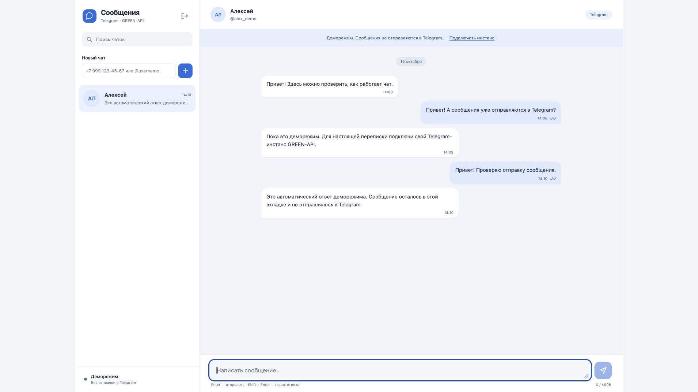

# Telegram-чат через GREEN-API

Тестовое задание на React: подключение инстанса, создание чата по номеру телефона, отправка и получение текстовых сообщений в Telegram. Интерфейс использует компоновку веб-чата MAX: список чатов слева, переписка справа, поле сообщения внизу. Мессенджер реализации — **Telegram**, что допускает исходное задание.

## Локальный запуск

Нужен Node.js 22.12+ и npm. Перейдите в каталог проекта и выполните:

```sh
npm ci
npm run dev
```

Откройте [http://127.0.0.1:5173](http://127.0.0.1:5173). Переменные окружения, сервер приложений и база данных не нужны.

Чтобы проверить интерфейс без ключей, нажмите **«Посмотреть демо»**. Деморежим не делает запросов к GREEN-API и не отправляет сообщения в Telegram; ответ генерируется локально и явно помечен.

## Подключение Telegram

1. Создайте инстанс **Telegram** в [кабинете GREEN-API](https://console.green-api.com/) и авторизуйте свой Telegram-аккаунт по инструкции сервиса. Состояние инстанса должно быть `authorized`. Бот BotFather для этой реализации не нужен.
2. В настройках инстанса установите `incomingWebhook: "yes"`, очистите `webhookUrl`. Для обновления статусов исходящих сообщений включите `outgoingWebhook: "yes"`. После изменения настроек дождитесь их применения (около минуты). Приложение проверяет настройки, но не меняет их автоматически.
3. Скопируйте `apiUrl`, `idInstance` и `apiTokenInstance` из карточки инстанса в форму приложения. `apiUrl` может содержать номер сервера, например `https://4100.api.green-api.com`.
4. Нажмите **«Подключить Telegram»**.
5. Введите номер получателя с кодом страны, например `+79991234567`, и нажмите **«+»**. Если поиск по номеру запрещён приватностью Telegram, используйте публичный `@username`.
6. Напишите текст, нажмите Enter или кнопку отправки. Shift + Enter добавляет строку. Максимальная длина — 4096 символов.
7. Ответьте с аккаунта получателя в Telegram. Ответ появится в чате через очередь уведомлений.

Для проверки используйте отдельный тестовый инстанс и второй Telegram-аккаунт. Очередь GREEN-API общая для инстанса: другой потребитель уведомлений может забирать ответы раньше этого приложения. Не запускайте несколько вкладок с одним инстансом.

## Реализация

React, TypeScript, Vite; стили на CSS без UI-фреймворка. Единственный внешний сервис — GREEN-API. В приложении нет файлов, звонков, группового администрирования и других функций за пределами тестового.

| Действие                                     | Метод GREEN-API                                 |
| -------------------------------------------- | ----------------------------------------------- |
| Проверка авторизации                         | `getStateInstance`                              |
| Проверка настроек получения                  | `getSettings`                                   |
| Поиск Telegram chatId по телефону / username | `checkAccount`                                  |
| Отправка текста                              | `sendMessage`                                   |
| Получение уведомления                        | `receiveNotification?receiveTimeout=20`         |
| Подтверждение обработки                      | `deleteNotification/{receiptId}` методом DELETE |

Номер телефона разрешается в Telegram `chatId` перед отправкой. Данные чатов, черновики, сообщения и токен живут только в памяти вкладки и очищаются при выходе или обновлении страницы. Отправленные в Telegram сообщения при этом сохраняются в самом Telegram.

Получение выполняется одним последовательным циклом long polling. Повторное уведомление не создаёт дубликат сообщения. Сетевые ошибки вызывают повтор получения с задержкой до 30 секунд; при HTTP 400/401/403 цикл останавливается и предлагает переподключение. Выход отменяет запросы и таймеры. Текст с URL принимается как обычный текст; неподдерживаемые медиа и служебные события подтверждаются и пропускаются, чтобы очередь продолжала двигаться. Статусы исходящих обновляются по уведомлениям; без них сообщение остаётся с отметкой «В очереди».

Исходящее сообщение не отправляется повторно автоматически: после сетевого сбоя неизвестно, принял ли его сервер. Интерфейс предлагает проверить Telegram и вернуть текст в поле для ручного повтора.

## Данные доступа

Токен не записывается в localStorage, sessionStorage, URL страницы, репозиторий или переменные Vite. Запросы идут из браузера прямо в HTTPS API GREEN-API; адрес API ограничен доменами `api.green-api.com` и их серверными поддоменами. Ошибки провайдера и URL запросов не выводятся в интерфейс или журналы приложения.

Это браузерное приложение: владелец вкладки видит свои запросы и токен в DevTools. Для сервиса с общими серверными ключами нужен отдельный backend, сессии и серверное хранение секретов. Для тестового ключи вводит сам пользователь, как требует задание.

Уведомление подтверждается после передачи сообщения в состояние приложения. Постоянного хранилища и загрузки истории нет: обновление вкладки очищает уже отображённую переписку. Деморежим и тесты с имитацией HTTP не доказывают реальную доставку в Telegram.

## Проверки и сборка

```sh
npm test
npm run build
npm run preview
```

Тесты Vitest проверяют контракт запросов, поиск получателя, настройки инстанса, ошибки, дедупликацию, очередь с повторным подтверждением, отмену получения и полный сценарий React-интерфейса с имитацией HTTP. GitHub Actions запускает тесты и сборку при push и pull request.

`npm run build` создаёт каталог `dist/`. Для публикации загрузите его на статический HTTPS-хостинг. Настройки сборки: `npm ci && npm run build`, выходной каталог `dist`, Node.js 22. Секреты в настройки хостинга добавлять не нужно. Проверка CORS и реального обмена с выделенным инстансом обязательна перед сдачей.

## Документация

- [Требования и готовность к сдаче](docs/acceptance.md)
- [Черновик письма работодателю](docs/submission-draft.md)
- [Отправка текста в Telegram](https://green-api.com/telegram/docs/api/sending/SendMessage/)
- [Поиск Telegram-аккаунта](https://green-api.com/telegram/docs/api/service/CheckAccount/)
- [Получение через HTTP API](https://green-api.com/telegram/docs/api/receiving/technology-http-api/)
- [Формат входящего текста](https://green-api.com/telegram/docs/api/receiving/notifications-format/incoming-message/TextMessage/)

Предпочтительный формат работы кандидата: **удалённо**.

## Скриншоты деморежима

Скриншоты показывают локальные тестовые данные, а не реальную доставку в Telegram.



[Мобильный экран](docs/screenshots/chat-mobile.jpg)
